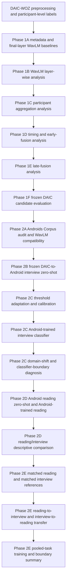

# Experiment Dependency Flow

This file records how the official experiments depended on earlier methodological choices. It is a documentation aid only and does not introduce new results.

## Text Flow

1. DAIC-WOZ preprocessing created participant-level speech windows and labels for Phase 1 development.
2. Phase 1A checked metadata-only and final-layer WavLM baselines.
3. Phase 1B selected WavLM layer 9 from train-only DAIC layer analysis.
4. Phase 1C retained participant mean aggregation for layer-9 embeddings.
5. Phase 1D compared timing-only, WavLM-only and early-fusion DAIC models.
6. Phase 1E tested late-fusion variants and retained timing-only as the stronger DAIC guided-interview candidate.
7. Phase 1F froze the WavLM free-speech candidate and the timing candidate for one provisional local DAIC test evaluation.
8. Phase 2A audited Androids Corpus and confirmed WavLM compatibility while rejecting direct DAIC timing transfer.
9. Phase 2B applied the frozen DAIC WavLM classifier zero-shot to Android interview speech.
10. Phase 2C separated frozen zero-shot reference, threshold-only adaptation, frozen-score calibration, Android-trained interview modeling and domain-shift analysis.
11. Phase 2D evaluated Android reading speech with both frozen DAIC zero-shot scoring and Android-trained reading classification.
12. Phase 2E used participant-coherent paired Android folds for matched-task, cross-task and pooled-task analysis.

## Mermaid Diagram

## Dependency Notes

- The Android phases depended on the Phase 1B/1C WavLM layer-9 mean representation.
- The DAIC timing candidate did not flow into Android modeling because Phase 2A found the required guided-interview timing features incompatible.
- Phase 2C depended on Phase 2B because adaptation and calibration needed the frozen DAIC score reference.
- Phase 2E depended on Phase 2D because the descriptive task comparison motivated a participant-coherent transfer design.
- The final manuscript interpretation depends on keeping each validation scope separate: cross-corpus zero-shot, target-domain adaptation, within-corpus Android training and cross-task transfer are not interchangeable.
